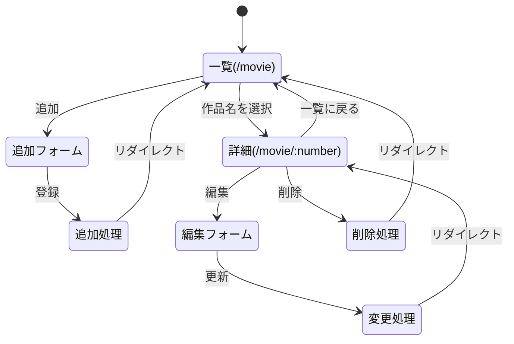
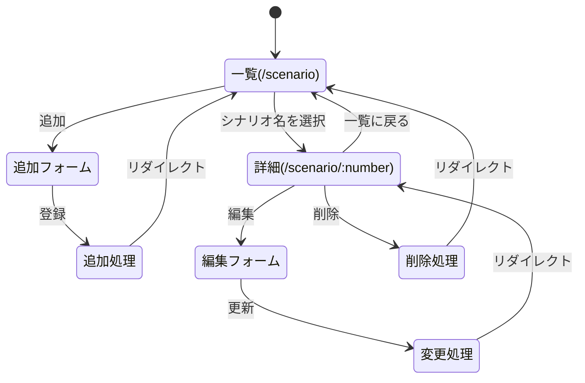
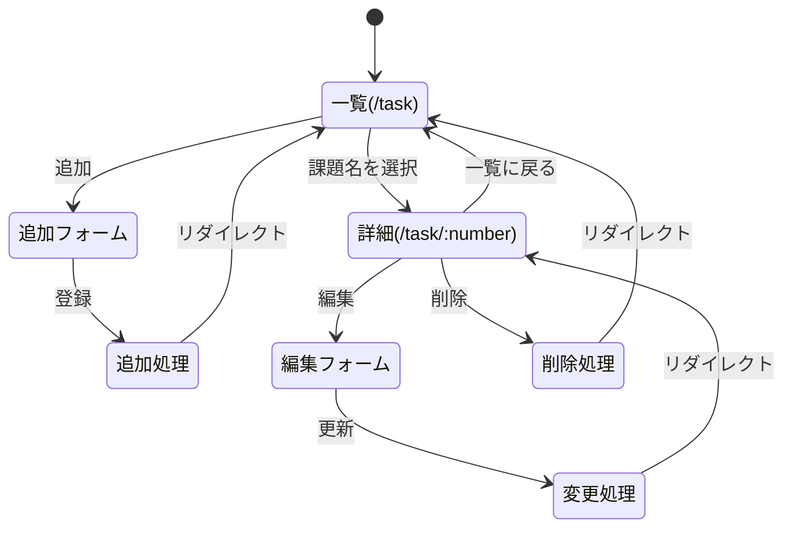

# レポート用システムの設計案

京葉線システム以外に開発する3つのWebアプリケーションの設計案である．
データは変数内に記録する．
一覧，詳細，追加，削除，変更の各処理はREST APIで実装する予定であり，
URLは次回以降の授業内容に合わせて見直す．

## 1. 映画鑑賞記録システム

### 対象
観た映画を記録し，あとから作品の情報や感想を見返したい利用者．

### スキーマ

項目名 | 型 | 内容 | 例
-|-|-|-
id | 数値 | 通し番号 | 1
title | 文字列 | 作品名 | 千と千尋の神隠し
director | 文字列 | 監督 | 宮崎駿
year | 数値 | 公開年 | 2001
genre | 文字列 | ジャンル | アニメ
rating | 数値 | 評価(1〜5) | 5
memo | 文字列 | 感想 | 何度観ても面白い

### ページ遷移図

## 2. TRPGシナリオ管理システム

### 対象
クトゥルフ神話TRPGのシナリオを管理し，卓を立てるときに人数や時間から候補を探したい利用者．

### スキーマ

項目名 | 型 | 内容 | 例
-|-|-|-
id | 数値 | 通し番号 | 1
title | 文字列 | シナリオ名 | (シナリオ名)
author | 文字列 | 作者 | (作者名)
players | 文字列 | 推奨人数 | 2〜4人
time | 数値 | 想定プレイ時間(時間) | 3
difficulty | 文字列 | 難易度 | 初心者向け
played | 真偽値 | プレイ済みかどうか | false
memo | 文字列 | メモ | ロスト率高め

### ページ遷移図

## 3. 課題管理システム

### 対象
複数の授業の課題やレポートの締切を一覧で確認し，提出漏れを防ぎたい学生．

### スキーマ

項目名 | 型 | 内容 | 例
-|-|-|-
id | 数値 | 通し番号 | 1
subject | 文字列 | 科目名 | Webプログラミング
title | 文字列 | 課題名 | 基本的なデータ表示のWebアプリ開発
deadline | 文字列(日付) | 締切日 | 2026-12-18
status | 文字列 | 状態 | 未着手/作業中/提出済
memo | 文字列 | メモ | 仕様書はMarkdown

### ページ遷移図

