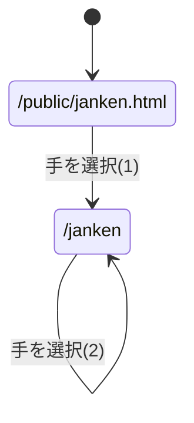
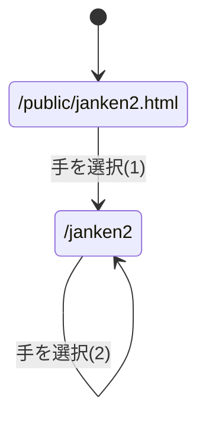
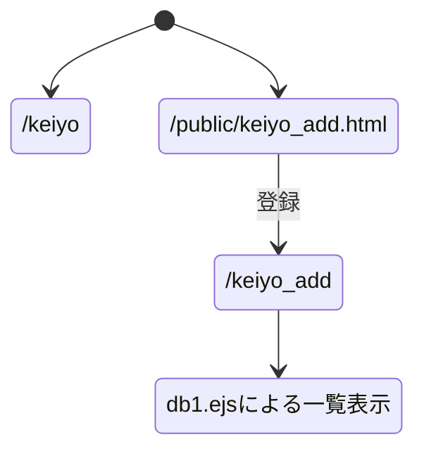
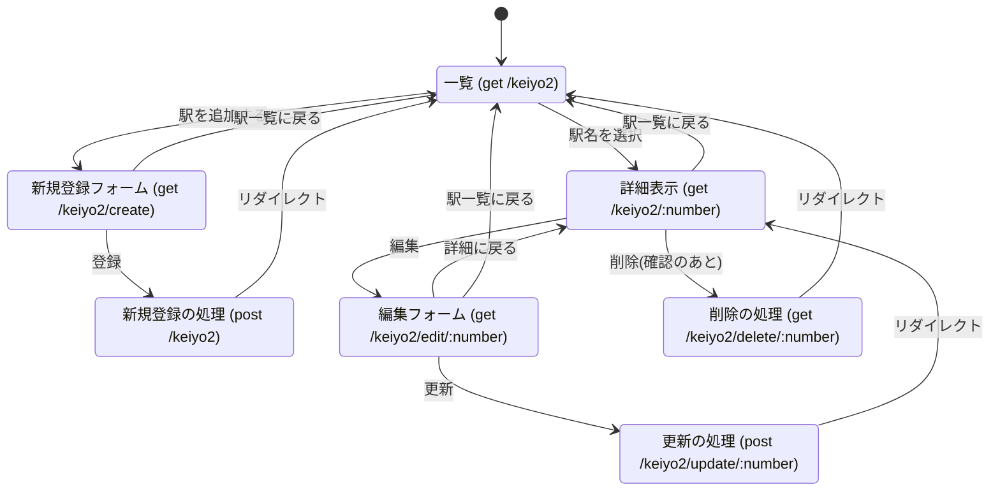
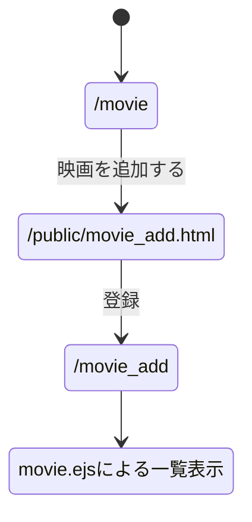

# webpro_06のページ遷移図

### じゃんけん関係
#### ページ遷移図

#### (1)のパラメータ

パラメータ名 | 属性 | 内容 | 値
-|-|-|-
hand | text | ユーザの手 | グー/チョキ/パー
win | hidden | 勝利数 | 0
total | hidden | 対戦数 | 0

#### (2)のパラメータ

パラメータ名 | 属性 | 内容 | 値
-|-|-|-
hand | text | ユーザの手 | グー/チョキ/パー
win | hidden | 勝利数 | これまでの勝利数
total | hidden | 対戦数 | これまでの対戦数

### じゃんけん
#### ページ遷移図

#### (1)のパラメータ

パラメータ名 | 属性 | 内容 | 値
-|-|-|-
hand | radio | ユーザの手 | グー/チョキ/パー
win | hidden | 勝利数 | 0
total | hidden | 対戦数 | 0

#### (2)のパラメータ

パラメータ名 | 属性 | 内容 | 値
-|-|-|-
hand | radio | ユーザの手 | グー/チョキ/パー
win | hidden | 勝利数 | これまでの勝利数
total | hidden | 対戦数 | これまでの対戦数

### 京葉線の駅
#### ページ遷移図

### 京葉線データベースアプリ keiyo2
第9回の詳細表示に，新規登録，編集・更新，削除を加えたもの．
第9回の `/keiyo2_add` と `/public/keiyo2_add.html` は，下の表のリソース名に置き換えた．

#### 機能とリソース名

機能 | method | リソース名 | 処理のあとの表示
-|-|-|-
一覧 | get | /keiyo2 | keiyo2.ejs
新規登録フォーム | get | /keiyo2/create | /public/keiyo2_new.html へリダイレクト
詳細表示 | get | /keiyo2/:number | keiyo2_detail.ejs
編集フォーム | get | /keiyo2/edit/:number | keiyo2_edit.ejs
新規登録の処理 | post | /keiyo2 | /keiyo2 へリダイレクト
更新の処理 | post | /keiyo2/update/:number | /keiyo2/:number へリダイレクト
削除の処理 | get | /keiyo2/delete/:number | /keiyo2 へリダイレクト

`:number` は一覧の上から何番目か(0始まり)を表す．

#### ページ遷移図

#### 新規登録と更新のパラメータ

パラメータ名 | 属性 | 内容 | 値
-|-|-|-
code | text | 駅コード | JE01 など
name | text | 駅名 | 東京駅 など
change | text | 乗り換え線 | 空でもよい
passengers | number | 乗降客数 | 0以上
distance | number | 東京駅からの距離(km) | 0以上

### 映画の一覧
#### ページ遷移図

